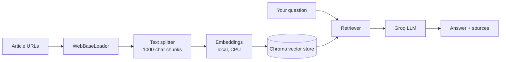

# Real Estate Research Tool

A Retrieval-Augmented Generation (RAG) app for real estate research. Paste the URLs of up to three articles, and the app reads them and answers your questions using only what those articles say, with the source URLs shown next to each answer.

Built with LangChain, Chroma, Hugging Face embeddings, Groq, and Streamlit.

## Features

- Load real estate, mortgage, and housing market articles straight from URLs
- Ask questions in plain English and get answers grounded in the loaded articles
- See the source URLs behind every answer
- Live progress messages while the articles are processed
- Honest "I don't have enough information" replies when the articles don't cover a question
- Light on hardware: embeddings run locally on CPU with a small model, and the chat model runs remotely on Groq

## How it works



1. **Load:** `WebBaseLoader` downloads the pages with a browser-style User-Agent.
2. **Clean:** blocked pages ("Access Denied") and empty pages are dropped before storage.
3. **Split:** `RecursiveCharacterTextSplitter` cuts the text into 1000-character chunks with 200 characters of overlap.
4. **Embed and store:** chunks are embedded with `sentence-transformers/paraphrase-MiniLM-L3-v2` and saved in a persistent Chroma collection.
5. **Retrieve and answer:** your question is embedded, the most similar chunks are retrieved, and `RetrievalQAWithSourcesChain` sends them to a Groq-hosted model (`openai/gpt-oss-20b`) to write the answer.

## Tech stack

| Part | Tool |
|---|---|
| UI | Streamlit |
| Orchestration | LangChain (`langchain`, `langchain-classic`, `langchain-community`, `langchain-text-splitters`) |
| Vector database | Chroma (`langchain-chroma`) |
| Embeddings | Hugging Face `paraphrase-MiniLM-L3-v2` (`langchain-huggingface`) |
| LLM | Groq, `openai/gpt-oss-20b` (`langchain-groq`) |
| Config | `python-dotenv` |
| Package manager | [uv](https://docs.astral.sh/uv/) |

## Project structure

```
Real_Estate_assistant_using_rag/
├── pyproject.toml
├── uv.lock
├── .env                          # your GROQ_API_KEY (not committed)
└── src/
    └── real_estate_assistant_using_rag/
        ├── main.py               # Streamlit UI
        ├── rag.py                # loading, splitting, embedding, retrieval, answering
        └── resources/
            └── vectorstore/      # persisted Chroma data (created automatically)
```

## Getting started

### Prerequisites

- Python 3.10 or newer (see `requires-python` in `pyproject.toml`)
- [uv](https://docs.astral.sh/uv/getting-started/installation/)
- A free [Groq API key](https://console.groq.com/)

### Setup

```powershell
# 1. Go to the project folder
cd Real_Estate_assistant_using_rag

# 2. Install dependencies into the project's own .venv
uv sync

# 3. Add your API key
"GROQ_API_KEY=your_key_here" | Out-File -Encoding ascii .env
```

If `uv sync` reports a missing package, add it with `uv add langchain-classic beautifulsoup4`.

### Run the app

```powershell
uv run streamlit run src\real_estate_assistant_using_rag\main.py
```

Use `uv run` so the app starts inside the project's environment and not another Python on your machine (for example conda's).

### Run the backend on its own (quick test)

```powershell
uv run python src\real_estate_assistant_using_rag\rag.py
```

This loads two sample articles, asks one question, and prints the answer and sources, with no Streamlit needed.

## Usage

1. Paste one to three article URLs into the sidebar.
2. Click **Process URLs** and wait for the "URLs processed" message. The first run is slower because the embedding model downloads once.
3. Type a question in the main panel.
4. Read the answer and the sources listed under it.

Processing URLs replaces whatever was stored before, so each batch of articles starts from a clean knowledge base.

## Example test run

Good pages to try, because they load without being blocked:

- `https://en.wikipedia.com/wiki/REIT`
- `https://tradingeconomics.com/united-states/30-year-mortgage-rate/news/588887`

Questions to ask:

- What percentage of taxable income must a US REIT pay out as dividends?
- Who signed the law creating REITs in the US, and when?
- Which REITs are listed on India's National Stock Exchange?
- What was the 30-year fixed mortgage rate on October 1, 2026?
- How do rising interest rates affect REITs, and what are mortgage rates right now?

Also try a question the articles don't cover, such as "What is the average home price in Mumbai?" A healthy RAG says it doesn't have enough information and does not invent a number.

## Configuration

Settings are at the top of `rag.py`:

| Setting | Default | Notes |
|---|---|---|
| `chunk_size` | `1000` | Size of each text chunk |
| `embedding_model_name` | `sentence-transformers/paraphrase-MiniLM-L3-v2` | Small CPU-friendly model; `all-MiniLM-L6-v2` or `BAAI/bge-small-en-v1.5` give better retrieval at slightly higher cost |
| `collection_name` | `real_estate_docs` | Chroma collection name |
| LLM model | `openai/gpt-oss-20b` | Any Groq-hosted chat model |
| `temperature` | `0` | Keep low so answers stay grounded in the articles |

Check the [Groq model list](https://console.groq.com/docs/models) for the models currently available.

## Troubleshooting

| Problem | Fix |
|---|---|
| Answers say "I don't have enough information" for everything | The page was probably blocked or empty. Test with Wikipedia or an official site, and check what was stored |
| `Access Denied` or "No usable content loaded" | The site blocks scrapers (many large news sites do). Use a different source |
| `ModuleNotFoundError` | Start the app with `uv run` so it uses the project's `.venv` |
| `Distribution not found ... Real_Estate Assistant using rag` | A parent `pyproject.toml` still lists the old folder name. Exclude this project from the parent workspace or fix the path |
| Windows error 1455 ("paging file is too small") | Close other heavy programs and increase the Windows virtual memory (page file) |
| A code change doesn't take effect | Stop Streamlit with `Ctrl+C` and start it again |
| Authentication error from Groq | Check that `.env` contains a valid `GROQ_API_KEY` and sits in the project root |

## Known limitations

- Some websites block automated requests, so not every URL can be loaded.
- Answers are only as good as the loaded pages. The app has no live web search.
- Each "Process URLs" run replaces the previous knowledge base.
- Pages that need JavaScript to show their content may load as empty text.

## Ideas for next steps

- Upload PDFs and text files as additional sources
- Keep several knowledge bases side by side instead of resetting
- Add chat history so follow-up questions work
- Show the retrieved chunks in the UI for easier debugging
- Add a `.gitignore` entry for `.env`, `.venv`, and `resources/vectorstore`